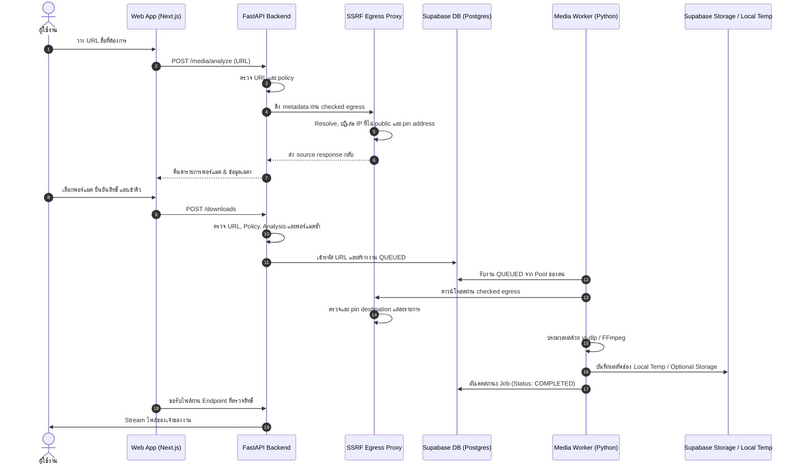

# คู่มือพัฒนาและผังสถาปัตยกรรมระบบ (Developer Onboarding & Architecture Guide)

> **ภาษา:** [English](../en/DEVELOPER_GUIDE.md) · **ภาษาไทย**

ยินดีต้อนรับสู่ศูนย์รวมเอกสารสำหรับนักพัฒนา (Developer Documentation Hub) ของโปรเจกต์ Media Loader คู่มือนี้สรุปข้อมูลสถาปัตยกรรม คำสั่ง เครื่องมือ และข้อกำหนดที่จำเป็นสำหรับการพัฒนาและต่อยอดระบบ

---

## 1. ผังสถาปัตยกรรมโปรเจกต์ (Project Architecture Overview)

Media Loader ถูกออกแบบในรูปแบบ Decoupled Monorepo:

```text
media-loader/
├── apps/
│   ├── web/                 # Next.js 16 Frontend (App Router, Tailwind, Drizzle)
│   ├── api/                 # FastAPI Backend Service (URL analysis & Policy engine)
│   ├── worker/              # Python Media Worker (Queue listener, yt-dlp, FFmpeg)
│   └── proxy/               # Public-IP egress proxy สำหรับ request จาก URL ผู้ใช้
├── apps/web/lib/db/
│   └── schema.ts            # แหล่งข้อมูลหลักของตารางและคอลัมน์แอปพลิเคชัน
├── supabase/
│   ├── rls_policies.sql     # นโยบาย Supabase Row Level Security
│   ├── profile_trigger.sql  # ฟังก์ชันและ Trigger สร้างโปรไฟล์จาก Auth
│   └── migrations/          # Migration เริ่มต้นในอดีต ห้ามเพิ่มการแก้ schema ใหม่ที่นี่
└── docs/                    # คู่มือสถาปัตยกรรมและข้อกำหนดทางเทคนิค
```

### การไหลของข้อมูลในระบบ (Data Flow Diagram)



---

## 2. รวมคำสั่งสำคัญสำหรับนักพัฒนา (Developer Command Reference)

ฟอร์มสมัครสมาชิกและตั้งรหัสผ่านใหม่กำหนดความยาวอย่างน้อย 8 ตัวอักษร โดยไม่บังคับ
ให้ผสมชนิดอักขระ ข้อกำหนดนี้ตรวจใน web form ส่วน Supabase Auth ต้องตั้ง password
policy ฝั่ง provider แยกต่างหากเพื่อบังคับใช้ฝั่ง server ฟอร์มแสดงคำแนะนำให้ใช้
passphrase ที่จำได้และไม่ซ้ำกับบริการอื่น เมื่อกรอกช่องยืนยันรหัสผ่านแล้วจะแสดงผล
ว่ารหัสผ่านตรงกันหรือไม่ ฟอร์มตรวจข้อมูลหลัง blur หรือ submit อัปเดตข้อความระหว่างแก้
และย้าย focus ไปช่องแรกที่ผิดเมื่อ submit ชื่อที่แสดงเป็นข้อมูลเสริม ส่วนฟอร์มล็อกอิน
รับรหัสผ่านของบัญชีเดิมโดยไม่ใช้ข้อกำหนดรหัสผ่านใหม่หรือแสดงคำแนะนำดังกล่าว

การสมัครด้วยอีเมลที่ยังไม่มี session จะแสดงหน้าตรวจอีเมลและล้างช่องรหัสผ่าน
มีปุ่มส่งอีเมลยืนยันซ้ำพร้อม cooldown 60 วินาทีที่หน้าเว็บ และยังอยู่ภายใต้ rate limit
ของ provider ผู้ใช้กลับไปแก้อีเมลได้ ช่องอีเมลเปิดคีย์บอร์ดแบบ email และปิดการขึ้นต้น
ตัวพิมพ์ใหญ่กับ spellcheck ปุ่ม Google และปุ่มอีเมลใช้ข้อความเฉพาะสำหรับสมัครสมาชิก
ข้อความความเป็นส่วนตัวบนหน้า Landing แจ้งว่าระบบประมวลผลสื่อชั่วคราวและลบไฟล์อัตโนมัติ

ตารางแพลตฟอร์มในหน้า Landing สรุปความละเอียดวิดีโอและการรองรับ MP3/GIF
ด้วยเครื่องหมายและข้อความสั้น ๆ แต่ละแพลตฟอร์มกดขยายเพื่อดูเงื่อนไขของไฟล์
และข้อมูลขนาดไฟล์ได้ ส่วนมือถือใช้รูปแบบสรุปและรายละเอียดเดียวกัน

คำสั่งการพัฒนาหลักทั้งหมดสามารถรันได้โดยตรงจาก Root Directory ของโปรเจกต์ผ่าน `pnpm`:

### การจัดการสภาพแวดล้อมและ Dependencies

```bash
# คัดลอกแม่แบบไฟล์ Environment
cp .env.example .env.local

# ติดตั้ง Dependencies ของทั้ง Node.js และ Python ใน Monorepo
pnpm install
pnpm setup:py

# ตรวจสอบความถูกต้องของ Environment Variables โดยไม่พิมพ์รหัสลับออกมา
pnpm check-env
```

### การสั่งรันบริการ Local Development

`pnpm dev` จะเปิด SSRF egress proxy ที่ `127.0.0.1:3128` พร้อมบริการอื่น
ถ้ารัน API หรือ Worker แยกเดี่ยว ให้เปิด proxy ก่อนด้วย `pnpm dev:proxy`

กำหนด `MEDIA_URL_ENCRYPTION_KEY` เป็น Fernet key ค่าเดียวกันให้ API และ Worker
ดูวิธีสร้าง key, ตั้ง proxy และย้าย URL แถวเดิมที่
[Environment Variables](ENVIRONMENT_VARIABLES.md)

```bash
# ค่าเริ่มต้น: เปิด Web, FastAPI แบบ reload, Worker และ egress proxy ใน Terminal เดียว
pnpm dev

# เหมือนกัน แต่เขียน log ทุกบริการลง tmp/dev.log (git-ignored)
# ให้ AI Agent มาตามอ่านทีหลังได้: pnpm dev:log
```

ใช้ `pnpm dev:web`, `pnpm dev:api` หรือ `pnpm dev:worker` เมื่อต้องการแยกตรวจ
เฉพาะบริการ หลังโค้ดนิ่งแล้วใช้ `pnpm docker:up` เพื่อตรวจ API/Worker ในสภาพ
production-like โดย Docker ไม่ใช่วงจรแก้โค้ดหลัก

ถ้าต้องการ rebuild Docker stack ทั้งหมดรวม Cloudflare tunnel ให้ใส่ profile
`tunnel` ด้วย ไม่งั้น container tunnel เดิมจะไม่ถูกสร้างใหม่:

```bash
docker compose --profile tunnel up -d --build
```

### การทดสอบ (Testing)

```bash
# รัน Unit Tests ทุก Service
pnpm test:web       # ทดสอบ Frontend (Node test runner)
pnpm test:api       # ทดสอบ FastAPI (pytest)
pnpm test:worker    # ทดสอบ Media Worker (pytest)

# ทดสอบ E2E
pnpm test:e2e       # ทดสอบ Playwright Mock บน Frontend
pnpm test:api:e2e   # ทดสอบ E2E API/Worker ด้วย Python script
```

คำสั่ง `pnpm test:e2e` ใช้ Playwright mock config แยกจาก Local Development
โดยเปิด Supabase Auth mock ที่ `localhost:9999` และ Next.js สำหรับทดสอบที่
`localhost:3100` พร้อม build directory `.next-mock` ของตัวเอง การพัฒนาปกติใช้
`localhost:3000` config จะเริ่ม server สำหรับทดสอบเอง และจะหยุดด้วยข้อผิดพลาด
หาก port ทดสอบถูกใช้อยู่ แทนการ reuse เว็บแอปอื่น Frontend E2E stub คำขอ FastAPI
ใน flow ที่เรียกใช้ และกำหนด FastAPI base URL เป็น
`http://127.0.0.1:18999` เพื่อไม่ให้ test ใช้ค่า API ของนักพัฒนา
ส่วนพฤติกรรม API และ Worker ตรวจด้วย test suite ของแต่ละบริการ
เทสต์ download ตรวจว่าไม่มีการสร้างงานก่อนคลิกปุ่มเดียว “ยืนยันสิทธิ์และดาวน์โหลด”
(ภาษาอังกฤษใช้ “Confirm rights and download”) และตรวจ request ว่าส่ง
`rights_confirmed: true`

### การตรวจสอบคุณภาพโค้ด (Linting & Formatting)

```bash
# ตรวจสอบ Linting ทุก Service พร้อมกัน (ESLint + Ruff + Markdownlint)
pnpm lint

# หรือตรวจแยกเฉพาะส่วน:
pnpm lint:web       # Next.js (ESLint)
pnpm lint:api       # FastAPI (Ruff)
pnpm lint:worker    # Media Worker (Ruff)
pnpm lint:md        # Markdown files (markdownlint-cli2)
pnpm lint:md:fix    # Auto-fix Markdown formatting

# จัดรูปแบบโค้ดอัตโนมัติ (Prettier + Ruff Format)
pnpm format
pnpm format:web     # Prettier
pnpm format:api     # Ruff format
pnpm format:worker  # Ruff format
```

### การตรวจจับ Dead Code และไฟล์ที่ไม่ได้ใช้งาน (Dead Code Audit)

```bash
# ตรวจสอบ Dead Code ทั่วทั้ง Monorepo (Knip + Vulture)
pnpm deadcode

# ตรวจจับเฉพาะส่วน:
pnpm deadcode:web     # Next.js (Knip: ตรวจจับ Unused files/exports/dependencies)
pnpm deadcode:api     # FastAPI (Vulture: ตรวจจับ Unused functions/classes/variables)
pnpm deadcode:worker  # Worker (Vulture)
```

### การจัดการฐานข้อมูล (Drizzle ORM)

`drizzle.config.ts` อ่านเฉพาะ `process.env` จึงไม่โหลดไฟล์ environment เมื่อ
`pnpm deadcode` import config ส่วน `db:generate` ไม่ต้องใช้ credentials ของฐานข้อมูล
คำสั่ง `db:push`, `db:pull` และ `db:studio` โหลด `.env.local` ที่ root อย่างชัดเจน
เมื่อมีไฟล์ โดยใช้ `--env-file-if-exists` ของ Node ค่าที่ shell หรือ CI ส่งมาแล้ว
มีลำดับความสำคัญสูงกว่า Agent ต้องไม่รันคำสั่งที่โหลดไฟล์เหล่านี้กับ credentials จริง
ผู้ใช้เป็นผู้รันในเครื่องของตนเอง

```bash
# Push การอัปเดต Schema ไปยัง Supabase / PostgreSQL
pnpm --filter web db:push
```

---

## 3. ดัชนีเอกสารทางเทคนิค (Documentation Index)

รายละเอียดเชิงลึกของแต่ละส่วนงานสามารถอ่านเพิ่มเติมได้ในไดเรกทอรี `docs/`:

| เอกสาร | วัตถุประสงค์และเนื้อหา |
| :--- | :--- |
| **[USER_SETUP_GUIDE.md](USER_SETUP_GUIDE.md)** | ขั้นตอนการขอรหัสผ่านและสร้างคีย์จาก Supabase & Google Cloud |
| **[ARCHITECTURE.md](ARCHITECTURE.md)** | สถาปัตยกรรมระบบโดยละเอียด ขอบเขตความปลอดภัย และการไหลของข้อมูล |
| **[API_SPEC.md](API_SPEC.md)** | ข้อกำหนด REST API Endpoints ของ FastAPI, Request Schemas และ Response Formats |
| **[DATABASE_SCHEMA.md](DATABASE_SCHEMA.md)** | โครงสร้างตารางฐานข้อมูล ความสัมพันธ์ โมเดลสถานะ และการตั้งค่า Drizzle ORM |
| **[SECURITY_AND_POLICY.md](SECURITY_AND_POLICY.md)** | กฎการตรวจสอบสิทธิ์, การป้องกัน SSRF และข้อกำหนดของ Policy Engine |
| **[SUPABASE_RLS_POLICY.md](SUPABASE_RLS_POLICY.md)** | นโยบาย Row Level Security (RLS) สำหรับแยกแยะข้อมูลผู้ใช้ |
| **[ENVIRONMENT_VARIABLES.md](ENVIRONMENT_VARIABLES.md)** | รายการค่าแปรสภาพแวดล้อมทั้งหมดทั้งที่จำเป็นและตัวเลือกเสริม |
| **[GOOGLE_OAUTH_SETUP.md](GOOGLE_OAUTH_SETUP.md)** | คู่มือการตั้งค่า Google OAuth ใน Supabase Dashboard |
| **[VERCEL_SETUP.md](VERCEL_SETUP.md)** | คู่มือการ deploy ส่วนของ Next.js Frontend ขึ้น Vercel |
| **[SECRETS_PROTOCOL.md](SECRETS_PROTOCOL.md)** | โปรโตคอลความปลอดภัยและการจัดการรหัสผ่านสำหรับนักพัฒนาและ AI Agent |

---

## 4. วงจรสถานะงาน (Status Model Lifecycle)

คิวงานใน Media Loader เปลี่ยนสถานะตามลำดับขั้นตอนดังนี้:

```text
PENDING ──> ANALYZING ──> READY ──> QUEUED ──> DOWNLOADING ──> CONVERTING ──> UPLOADING ──> COMPLETED

PENDING / READY / QUEUED / DOWNLOADING / CONVERTING ──> PAUSED ──> QUEUED (ทำงานต่อ)
ทุกสถานะ ──> FAILED
ทุกสถานะ ──> BLOCKED
PENDING / ANALYZING / READY / QUEUED / DOWNLOADING / CONVERTING / UPLOADING / PAUSED ──> CANCELLED
```

---

## 5. กฎและแนวทางการพัฒนา (Development Rules)

1. **เครื่องมือจัดการ Package**:
   - ใช้ `pnpm` สำหรับ Node.js Packages และการรันสคริปต์ในโปรเจกต์เสมอ
   - ใช้ `uv` สำหรับการจัดการ Virtual Environment และรัน Python Scripts (`uv venv`, `uv pip install`, `uv run`) เสมอ
2. **การรักษาความลับ (Secrets Handling)**:
   - ห้ามพิมพ์หรือบันทึกรหัสผ่านลับลงใน Log หรือ Console (เช่น `SUPABASE_SERVICE_ROLE_KEY`, `GOOGLE_CLIENT_SECRET`)
   - ห้าม commit ไฟล์ `.env.local` ลงใน Git Repository
3. **การเคารพสิทธิ์และนโยบาย (Rights Compliance)**:
   - ห้ามเขียนโค้ดเพื่อข้ามระบบ DRM, Paywall หรือหน้าต่างล็อกอินของแพลตฟอร์มใดๆ
   - ทุก URL ต้องผ่านการตรวจสอบในชั้น Policy ก่อนวิเคราะห์หรือดาวน์โหลดเสมอ
